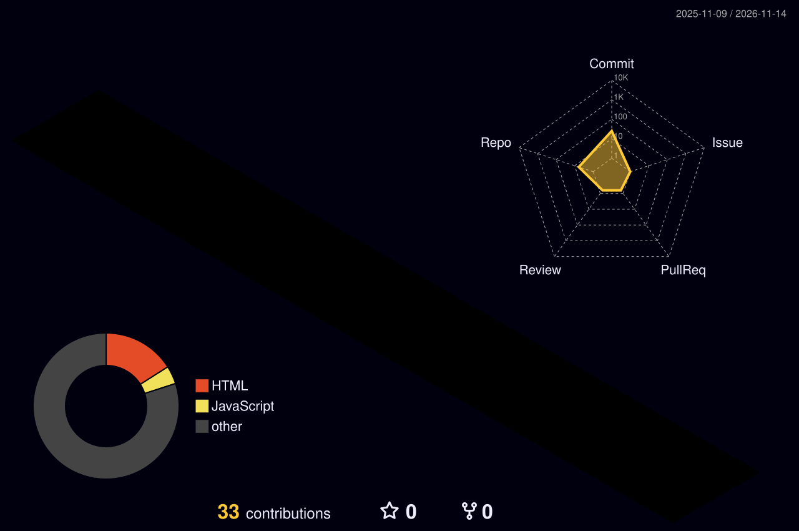

# ⚡ WELCOME TO MY DIGITAL UNIVERSE ⚡

### 👨‍💻 Developer | 🤖 IoT Enthusiast | 🚀 Tech Innovator

 

---

## 🚀 ABOUT ME

🔭 Exploring **IoT, Robotics and Embedded Systems**

🌱 Learning **Artificial Intelligence and Web Development**

💡 Interested in **Smart Automation and Innovative Technology**

⚡ Building projects using **Arduino, ESP32 and Raspberry Pi**

🎯 Mission: **Learn • Build • Innovate**

---

## 🛠️ TECH STACK

### 💻 Programming & Web Development

### 🤖 Hardware & Development Tools

---

## 📊 GITHUB STATISTICS

 

---

## 🔥 CONTRIBUTION STREAK

---

## 🐍 MY CONTRIBUTION SNAKE

---

## 🌟 FEATURED PROJECTS

### 💧 AquaNexa
Smart Water Purification and Quality Monitoring System with Digital Twin and Adaptive Purification.

### 🤖 Robotics & Automation
Exploring robotics, sensors, microcontrollers and intelligent automation.

### 🌐 Web Development
Building responsive websites and interactive web applications.

---

## 💬 CONNECT WITH ME

---

### ⚡ CODE • CREATE • INNOVATE ⚡

**Thanks for visiting my GitHub profile! 🚀**

<h2>🏆 MY GITHUB TROPHIES 🏆</h2>

<h2>🌌 MY 3D CONTRIBUTION GRAPH</h2>

<h2>💻 DEVELOPER MODE: ON ⚡</h2>

<h3>⚡ Eat • Sleep • Code • Repeat ⚡</h3>

<h2>🚀 MY FEATURED PROJECTS</h2>

  

  

<h2>⚡ CODE • CREATE • INNOVATE ⚡</h2>

## ⚡ MY LATEST GITHUB ACTIVITY

<!--START_SECTION:activity-->
1. ❗ Opened issue [#1](https://github.com/patradurgaprasad6-sudo/ENERGYINTEL-AI/issues/1) in [patradurgaprasad6-sudo/ENERGYINTEL-AI](https://github.com/patradurgaprasad6-sudo/ENERGYINTEL-AI)
<!--END_SECTION:activity-->

<h2>🎮 PAC-MAN CONTRIBUTION GRAPH</h2>

<h2>🌐 EXPLORE MY DIGITAL WORLD</h2>

